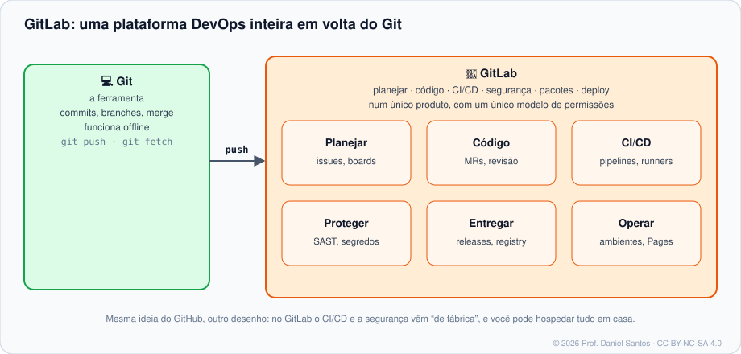

<div align="center">

# 🦊 GitLab: DevOps de Ponta a Ponta

### Curso 3 da jornada do desenvolvedor — aberto, prático e verificável

*Material didático gratuito e aberto — para uso não comercial.*

[](LICENSE)
[](LICENSE-CONTEUDO.md)
[](https://github.com/dsantos-docencia/gitlab/actions)
[](CONTRIBUTING.md)

</div>

---

## 👋 Boas-vindas

Olá! Eu sou o **Professor Daniel Santos**: desenvolvedor, provedor de serviços de tecnologia e professor de cursos técnicos de TI e segurança cibernética.

No [curso de Git](https://github.com/dsantos-docencia/git) você aprendeu a **ferramenta**; no [curso de GitHub](https://github.com/dsantos-docencia/github), a plataforma de colaboração mais popular. Aqui você aprende a plataforma que nasceu para ser **o ciclo DevOps inteiro num lugar só** — planejamento, código, revisão, CI/CD, registry, segurança e implantação — e que você pode **hospedar no seu próprio servidor**, como fazem governos, bancos e universidades.

Como nos outros cursos da trilha, cada conceito vem com **o porquê**, cada exemplo **roda de verdade** (uma esteira automática executa tudo a cada alteração) e cada exercício tem **correção automática**. Para corrigir exercícios de GitLab **sem internet e sem token**, o curso traz um **`glab` simulado** que registra o que o seu script pede à plataforma, e valida cada `.gitlab-ci.yml` contra o **schema oficial**. Quando quiser, os exemplos rodam no **GitLab de verdade** — no GitLab.com ou num **GitLab CE + Runner no seu notebook**, com um comando. Cada módulo termina com as **fontes oficiais** (docs.gitlab.com e o manual do `glab`).

> *"Uma plataforma, um pipeline, uma fonte da verdade — e a chave do servidor pode ser sua."* — Prof. Daniel

---

## 🧭 A trilha da jornada do desenvolvedor

| Curso | Foco | Repositório |
|---|---|---|
| 1 · Git | a ferramenta: versionar, ramificar, colaborar, investigar | [dsantos-docencia/git](https://github.com/dsantos-docencia/git) |
| 2 · GitHub | pull requests, Actions, segurança, comunidade open source | [dsantos-docencia/github](https://github.com/dsantos-docencia/github) |
| **3 · GitLab** ← você está aqui | merge requests, CI/CD integrado, componentes, DevSecOps, auto-hospedagem | [dsantos-docencia/gitlab](https://github.com/dsantos-docencia/gitlab) |
| 4 · Bitbucket | integração com Jira, Pipelines, times Atlassian | [dsantos-docencia/bitbucket](https://github.com/dsantos-docencia/bitbucket) *(em construção)* |



---

## 🗺️ Trilha de aprendizado

Cada módulo tem: **teoria** com cenário, diagramas, tabelas de comandos com variações e fontes oficiais (`README.md`), **exemplos executáveis comentados** (`exemplos/`) e **exercícios com correção automática** (`exercicios/`).

| # | Módulo | O que você domina | Horas | Status |
|---|---|---|---|---|
| 00 | [Boas-vindas e fundamentos](modulos/00-boas-vindas-e-fundamentos/) | GitLab × GitHub, GitLab.com × self-managed, planos, interface, GLFM, primeiros passos com o `glab` | 3–4 | ✅ |
| 01 | [Conta, segurança e autenticação](modulos/01-conta-seguranca-e-autenticacao/) | 2FA e passkeys, e-mail privado de commit, SSH (e `altssh` na porta 443), os tipos de token e seus prefixos | 4–5 | ✅ |
| 02 | [Projetos, grupos e permissões](modulos/02-projetos-grupos-e-permissoes/) | grupos e subgrupos, herança, os seis papéis (com o novo Planner), configurações de projeto pela API | 4–5 | ✅ |
| 03 | [Issues, labels e boards](modulos/03-issues-labels-e-boards/) | templates com quick actions, labels com escopo, milestones, boards, filas de triagem | 4–5 | ✅ |
| 04 | [Merge requests e code review](modulos/04-merge-requests-e-code-review/) | MRs revisáveis, drafts, CODEOWNERS com seções, templates, MR por *push options*, métodos de merge | 5–6 | ✅ |
| 05 | [Forks e contribuição](modulos/05-forks-e-contribuicao/) | fork × branch, sincronizar com o upstream, licença pela API, arquivos de saúde do projeto | 4–5 | ✅ |
| 06 | [Branches e tags protegidas](modulos/06-branches-e-tags-protegidas/) | quem faz push e merge, force push, tags de versão, proteção idempotente pela API, auditoria | 4–5 | ✅ |
| 07 | [GitLab CI/CD: fundamentos](modulos/07-gitlab-ci-fundamentos/) | anatomia do pipeline, etapas e `needs`, `rules` e `workflow`, variáveis, artefatos e dotenv, agendamentos | 5–6 | ✅ |
| 08 | [GitLab CI/CD: avançado](modulos/08-gitlab-ci-avancado/) | matriz, cache, `extends`/`!reference`, **componentes e CI/CD Catalog**, pai-filho, ambientes, OIDC, o seu Runner | 5–6 | ✅ |
| 09 | [Releases, pacotes, registry e Pages](modulos/09-releases-pacotes-e-pages/) | changelog pelos commits, releases com o `glab`, Package e Container Registry, GitLab Pages | 4 | ✅ |
| 10 | [DevSecOps](modulos/10-devsecops-e-seguranca/) | SAST, segredos, dependências por SBOM, contêiner, o que cada plano entrega, portão de segurança no Free, políticas | 4–5 | ✅ |
| 11 | [API, webhooks, espelhamento e administração](modulos/11-api-automacao-e-administracao/) | REST com paginação e GraphQL, tokens para robôs, webhooks seguros, espelhos, backup e atualização | 4–5 | ✅ |

🚀 **Projetos práticos**: [projetos/](projetos/) — kit de projeto “pronto para time”, auditor de higiene com nota de 0 a 10 e um **componente de CI/CD** pronto para o Catalog, com verificador. Todos com testes.

🧪 **Laboratório**: [laboratorio/](laboratorio/) — passo a passo para criar a conta, proteger com 2FA, instalar o `glab` e criar **o seu projeto de laboratório** com um comando; ou subir **o seu próprio GitLab CE + Runner** em Docker para praticar administração; ou estudar 100% offline.

🧰 **Scripts reais**: [scripts/](scripts/) — clonar um grupo inteiro com subgrupos, sua fila de revisões, labels com escopo padronizados, disparar e acompanhar pipelines, limpar pipelines antigos, auditar `.gitlab-ci.yml` e acessos, notas de versão e backup de issues. Todos testados.

📚 **Referência**: [referencia/](referencia/) — **cheat sheet do `glab` com exemplos e variações**, cheat sheet do GitLab CI/CD, GLFM + quick actions + atalhos, checklist de segurança, glossário e curadoria de fontes oficiais.

---

## 🚦 Começando em 3 passos

```bash
# 1. Clone o repositório
git clone https://github.com/dsantos-docencia/gitlab.git curso-gitlab
cd curso-gitlab

# 2. Rode um exemplo (simulado: sem internet, sem conta, nada é criado)
bash modulos/00-boas-vindas-e-fundamentos/exemplos/01-primeiros-comandos-glab.sh

# 3. Faça um exercício e corrija na hora
./ferramentas/corrigir.sh 07        # todos os exercícios do módulo 07
./ferramentas/corrigir.sh 07 02     # só o exercício 02
```

Quer ver no GitLab de verdade? Crie seu projeto de laboratório ([laboratorio/](laboratorio/)) e rode os exemplos marcados com `GLAB_REAL=1`:

```bash
GLAB_REAL=1 LAB_PROJETO=seu-usuario/lab-gitlab bash modulos/03-issues-labels-e-boards/exemplos/02-filas-de-trabalho.sh
```

Requisitos: Bash, Git, `jq` e `python3` com PyYAML (no Windows, use o **Git Bash** ou o WSL); `check-jsonschema` é recomendado para validar pipelines. Ambiente idêntico ao do professor: `./laboratorio/entrar.sh` (Docker).

---

## 🧰 O que torna este repositório diferente

- **Tudo roda.** A [verificação](.github/workflows/verificar.yml) executa ShellCheck, valida todo YAML, confere **todo `.gitlab-ci.yml` do curso contra o schema oficial do GitLab**, roda **todos** os exemplos e confere as soluções contra os testes a cada push.
- **Um `glab` simulado para aprender sem medo.** [`ferramentas/simulador/glab`](ferramentas/simulador/glab) registra cada chamada e responde com dados de um projeto fictício. O corretor confere *o que* você pediu ao GitLab (`glab api -X POST …/protected_branches -F push_access_level=40`) sem tocar na sua conta.
- **Pipeline tratado como dado.** Cada `.gitlab-ci.yml` é convertido para JSON e verificado campo a campo — inclusive `!reference`, componentes com `spec:inputs` e YAML de vários documentos.
- **Do GitLab.com ao seu servidor.** O laboratório sobe um **GitLab CE + Runner** com versões fixas, perfil de memória enxuto e atalhos para backup — para você ser **admin** e não só usuário.
- **Roda nas duas plataformas.** O mesmo verificador roda no GitHub Actions e, num espelho do GitLab, pelo [`.gitlab-ci.yml`](.gitlab-ci.yml) da raiz.
- **Fonte oficial em cada módulo** e **diagramas originais** em [assets/](assets/), licenciados junto com o conteúdo.

---

## 🤝 Contribuindo

> **Junte-se a mim e deixe algo de útil para o próximo.** 🌱 Conhecimento que não é compartilhado morre com quem o guarda.

- **Achou um erro ou tem uma ideia?** [Abra uma issue](https://github.com/dsantos-docencia/gitlab/issues/new/choose) ou mande um PR. Contribuir com este curso é o exercício final do Módulo 05. 😉
- **Tem um script ou pipeline útil?** Envie pela trilha **“📜 Enviar um script para a comunidade”**. Os aprovados entram em [`scripts/comunidade/`](scripts/comunidade/) com o seu crédito.
- **Fala outro idioma?** Ajude a traduzir ([guia](traducoes/README.md)). A versão em inglês está nos planos.

Leia o [guia de contribuição](CONTRIBUTING.md). Quem contribui entra em [CONTRIBUTORS.md](CONTRIBUTORS.md). 💚

---

## 📜 Licença e direitos

- **Código** (scripts, ferramentas, exemplos, pipelines): [PolyForm Noncommercial 1.0.0](LICENSE).
- **Conteúdo didático** (textos, exercícios, diagramas): [CC BY-NC-SA 4.0](LICENSE-CONTEUDO.md).
- **Uso comercial não é permitido** sem autorização do autor. Veja o [NOTICE](NOTICE.md).
- GitLab® e o logotipo da raposa (tanuki) são marcas da GitLab Inc. Este é um curso independente, sem vínculo com a empresa. A documentação oficial é **citada e apontada**, não reproduzida.

© 2026 **Daniel Santos (Prof. Daniel Santos)**. Todos os direitos reservados ao autor; as licenças acima são concedidas ao público.
