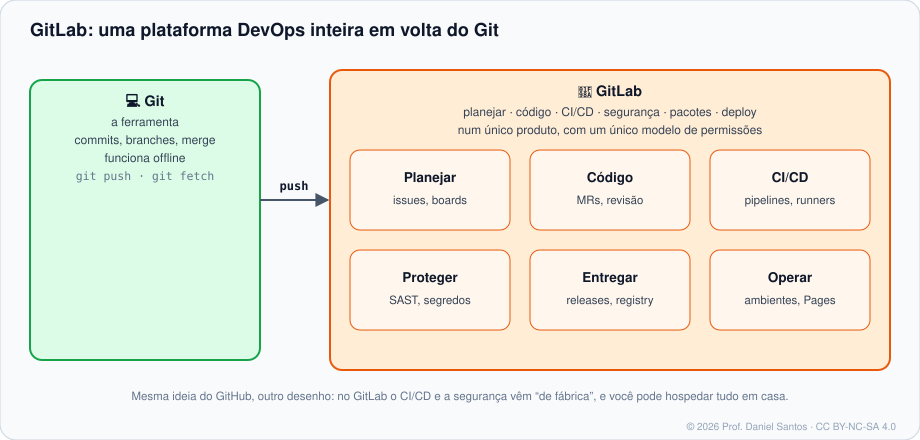
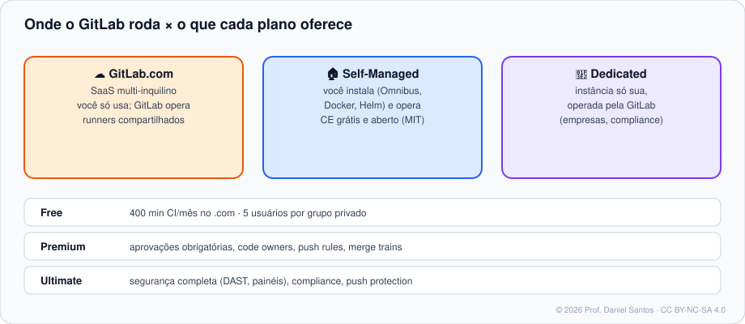
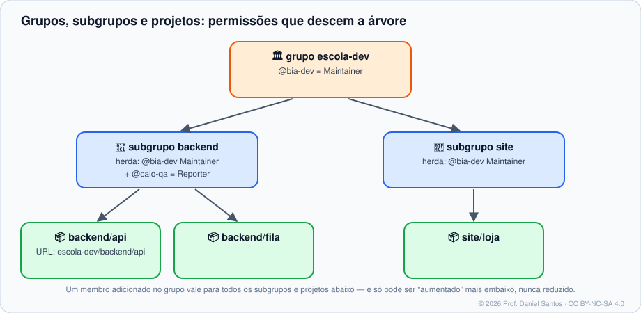
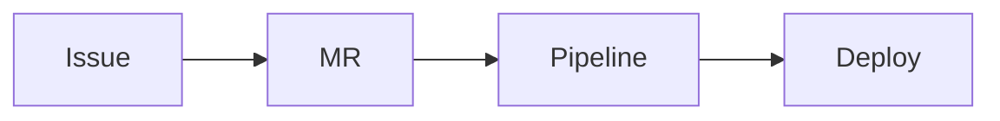

# Módulo 00 · Boas-vindas e fundamentos

> **Você vai sair daqui sabendo:** o que o GitLab é (e em que difere do GitHub), onde ele roda (GitLab.com, Self-Managed, Dedicated) e o que cada plano oferece, como grupos, subgrupos e projetos se organizam, a linguagem de referências do GitLab (`#`, `!`, `~`, `%`, `&`), o Markdown do GitLab e os primeiros passos com o `glab`, a CLI oficial.

⏱ 3–4 h · 🧪 [Laboratório](../../laboratorio/) · ✍️ [Exercícios](exercicios/)

---

## 1. Cenário

Você domina Git ([curso 1](https://github.com/dsantos-docencia/git)) e já trabalhou no GitHub ([curso 2](https://github.com/dsantos-docencia/github)). Agora o cliente — um hospital, uma prefeitura, um banco — diz: *“o código não pode sair da nossa rede”*. Ou a empresa nova usa GitLab porque quer **um único produto** para planejar, versionar, testar, escanear e implantar. O GitLab é a resposta para os dois casos: uma plataforma DevOps completa que você pode usar na nuvem **ou instalar no seu próprio servidor**.



## 2. GitLab × GitHub: mesmas ideias, outros nomes

| Conceito | GitHub | GitLab |
|---|---|---|
| Pedido de integração | pull request (`#7`) | **merge request** (`!7`) |
| Agrupar repositórios | organização (um nível) | **grupos e subgrupos** (árvore) |
| Repositório | repository | **projeto** (repositório + issues + CI + registry…) |
| Automação | GitHub Actions (`.github/workflows/*.yml`) | **GitLab CI/CD** (`.gitlab-ci.yml`, um arquivo) |
| Máquina que roda | runner | **GitLab Runner** |
| CLI oficial | `gh` | **`glab`** |
| Hospedar você mesmo | GitHub Enterprise Server (pago) | **GitLab CE: grátis e aberto (MIT)** |

> 🧠 **Por que aprender os dois?** Porque o mercado usa os dois — e porque comparar plataformas separa quem decorou cliques de quem entendeu os conceitos. Branch protegida, revisão obrigatória, CI com runner, token com escopo mínimo: a ideia é a mesma, só muda a tela.

## 3. Onde o GitLab roda e quanto custa



| Oferta | O que é | Para quem |
|---|---|---|
| **GitLab.com** | o serviço na nuvem da GitLab Inc. | quem não quer operar servidor |
| **Self-Managed** | você instala (pacote Omnibus, Docker, Kubernetes) e opera | dados na sua rede, controle total — o laboratório do curso usa isto |
| **Dedicated** | uma instância só sua, operada pela GitLab | empresas com exigências de compliance |

| Plano | Destaques (novembro de 2026) |
|---|---|
| **Free** | CI/CD, registry, Pages, issues, MRs; no GitLab.com: **400 minutos de CI por mês** e **até 5 usuários por grupo privado** |
| **Premium** | aprovações obrigatórias, code owners, push rules, merge trains, ambientes protegidos, 10.000 minutos |
| **Ultimate** | segurança completa (DAST, painéis de vulnerabilidade, políticas), compliance, 50.000 minutos |

> 💡 **Runner próprio não gasta minuto.** Os 400 minutos são só para os runners da GitLab. Um runner no seu notebook ou servidor (Módulo 08) roda ilimitado, em qualquer plano. E o **Self-Managed Free** não tem o limite de 5 usuários.

> ⚠️ Preços e cotas mudam. Antes de decidir, confira <https://about.gitlab.com/pricing/>. O GitLab lança uma versão nova todo mês (a 19.5 saiu em 15/10/2026), e as versões de correção saem a cada duas semanas.

## 4. Grupos, subgrupos e projetos



- **Namespace** é o “dono” no caminho da URL: o seu usuário (`gitlab.com/aluno/...`) ou um grupo (`gitlab.com/escola-dev/...`).
- **Grupos** têm **subgrupos** em vários níveis: `escola-dev/backend/api`. Membros, labels, variáveis de CI e runners definidos no grupo **descem** para tudo o que está abaixo.
- **Projeto** é mais que um repositório: tem issues, MRs, CI/CD, registry de containers e pacotes, wiki, Pages, ambientes.

## 5. A linguagem de referências do GitLab

Em qualquer campo de texto (issue, MR, commit, comentário), estes atalhos viram links:

| Escrevo | Aponta para |
|---|---|
| `#12` | issue 12 |
| `!7` | merge request 7 |
| `&3` | épico 3 (Premium) |
| `~bug` · `~"precisa de revisão"` | label (com espaço: entre aspas) |
| `%v1.1` · `%"Sprint 4"` | milestone |
| `$5` | snippet 5 |
| `@bia-dev` · `@escola-dev/backend` | pessoa · todos de um grupo (cuidado: notifica!) |
| `a1b2c3d` · `a1b2c3d...e4f5a6b` | commit · comparação |
| `escola-dev/loja#12` · `escola-dev/loja!7` | itens de **outro** projeto |

## 6. Markdown do GitLab (GLFM)

````markdown
[[_TOC_]]                         ← sumário automático das seções

> [!note]
> Alertas: note, tip, important, caution, warning.

- [x] tarefa feita
- [ ] tarefa pendente
- [~] tarefa “não se aplica”      ← exclusivo do GitLab

| Coluna | Outra |
|---|:---:|



Diagramas também em PlantUML e Kroki (se o administrador ligar).
````

## 7. O `glab`: o GitLab no terminal

```bash
# instalar
winget install --id GLab.GLab        # Windows
brew install glab                    # macOS / Linux com Homebrew
# Debian/Ubuntu: pacote .deb oficial em https://gitlab.com/gitlab-org/cli/-/releases

glab version
glab auth login                      # GitLab.com ou a sua instância (Módulo 01)
glab repo view escola-dev/loja       # README de um projeto
glab issue list -R escola-dev/loja   # issues de outro projeto
glab mr list --reviewer=@me          # o que esperam de você
glab ci status                       # pipeline da branch atual
glab api projects/:fullpath          # API REST com autenticação pronta
```

| Comando | Variações úteis |
|---|---|
| `glab <coisa> list` | `-R grupo/projeto` · `--output json` · `--per-page 100` · `--all` |
| `glab config set CHAVE VALOR` | `git_protocol ssh` · `editor "code --wait"` · `--global` · `--host gitlab.empresa.com` |
| `glab alias set NOME 'comando'` | `glab alias set minhas 'issue list --assignee=@me'` · `glab alias list` |

> 🧠 **O `glab` não tem `--jq`** como o `gh`. Use `--output json` e passe para o [`jq`](https://jqlang.org): `glab mr list --output json | jq -r '.[].title'`.

## 8. Como este curso funciona (o `glab` de mentira)

Os exercícios precisam de correção automática, mas o GitLab é um serviço na rede. A solução, a mesma do curso de GitHub, é um **simulador**: [`ferramentas/simulador/glab`](../../ferramentas/simulador/glab). Ele fica na frente do `glab` verdadeiro, **registra cada chamada** e responde com dados de um projeto fictício (`aluno/laboratorio`). O corretor confere *o que* o seu script pediu ao GitLab.

- **Exemplos** rodam simulados por padrão; muitos aceitam `GLAB_REAL=1 LAB_PROJETO=voce/lab-gitlab` para rodar contra o **seu** projeto de laboratório — no GitLab.com ou na **instância local em Docker** que o [laboratório](../../laboratorio/) ensina a subir.
- **Pipelines** (`.gitlab-ci.yml`) são validados contra o **schema oficial** do GitLab CI, e podem ser rodados localmente com o `gitlab-ci-local`.

## 9. Armadilhas comuns

- **Confundir caminho e nome.** O *nome* do projeto pode ter espaços e acentos (“Loja do Bairro”); o *caminho* (`loja-do-bairro`) é o que vai na URL e na API.
- **Grupo privado no GitLab.com com 6 pessoas** no Free: o namespace fica **somente leitura**. Planeje antes.
- **Mencionar `@grupo` inteiro** num comentário qualquer — notifica dezenas de pessoas.
- **Achar que `!7` e `#7` são a mesma coisa** — no GitLab, issue e MR têm numerações separadas.

## 📚 Fontes oficiais

> A documentação oficial do GitLab é publicada em inglês (com traduções parciais para alguns idiomas). Os links abaixo vão direto à página certa.

- Tutorial “GitLab em 15 passos” e visão geral: <https://docs.gitlab.com/tutorials/>
- Ofertas do GitLab (GitLab.com, Self-Managed, Dedicated): <https://docs.gitlab.com/subscriptions/choosing_subscription/>
- Planos e preços: <https://about.gitlab.com/pricing/>
- Grupos e subgrupos: <https://docs.gitlab.com/user/group/subgroups/>
- Referências do GitLab Flavored Markdown: <https://docs.gitlab.com/user/markdown/#gitlab-specific-references>
- GitLab Flavored Markdown: <https://docs.gitlab.com/user/markdown/>
- GitLab CLI (`glab`): <https://docs.gitlab.com/editor_extensions/gitlab_cli/>
- Notas de lançamento: <https://docs.gitlab.com/releases/>

---

<sub>© 2026 Prof. Daniel Santos · Curso de GitLab · conteúdo sob CC BY-NC-SA 4.0 · <a href="../../NOTICE.md">aviso de direitos</a></sub>
