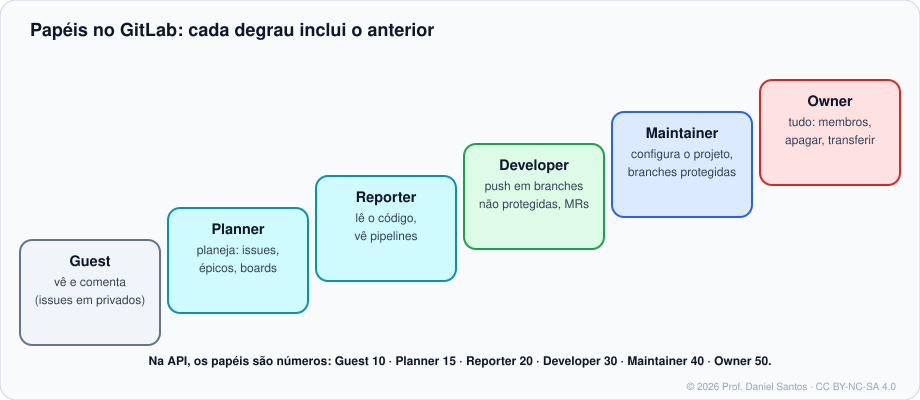
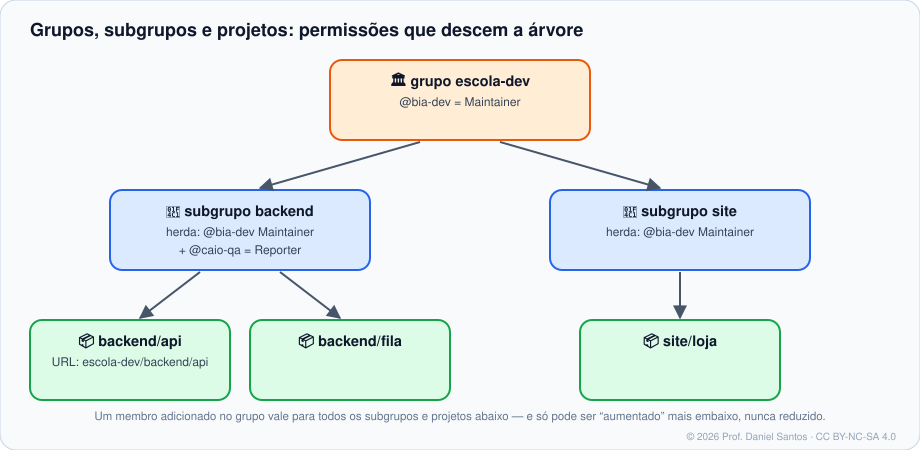

# Módulo 02 · Projetos, grupos e permissões

> **Você vai sair daqui sabendo:** criar grupos, subgrupos e projetos pela interface, pelo `glab` e pela API; escolher a visibilidade (privado, interno, público); configurar o que o projeto aceita (métodos de merge, pipeline obrigatório, apagar branch após o merge); dar a cada pessoa o papel certo — e entender a **herança** de permissões que é a marca registrada do GitLab.

⏱ 4–5 h · 🧪 [Laboratório](../../laboratorio/) · ✍️ [Exercícios](exercicios/)

---

## 1. Cenário

A Escola Dev vai organizar seus sistemas: um grupo `escola-dev`, com subgrupos `backend` e `site`, e projetos dentro de cada um. A Bia mantém tudo; o Caio testa só o backend; uma estagiária vai planejar o roadmap sem mexer em código. Num GitHub você faria isso projeto a projeto; no GitLab, você faz **uma vez no grupo** e a árvore cuida do resto.

## 2. Criando

```bash
# grupo (pela API; o glab ainda não tem "group create")
glab api -X POST groups -f name="Escola Dev" -f path=escola-dev -f visibility=private
# subgrupo: o mesmo, com parent_id
glab api -X POST groups -f name=Backend -f path=backend -F parent_id=901

# projeto dentro do grupo
glab repo create loja --group escola-dev --private --description "Loja do Bairro" --defaultBranch main --readme
# publicar uma pasta que já é repositório Git
git remote add origin git@gitlab.com:escola-dev/loja.git && git push -u origin main
```

> 💡 **Push cria projeto.** No GitLab, `git push` para um caminho que ainda não existe **cria o projeto** (privado) automaticamente no seu namespace ou num grupo onde você pode criar projetos: `git push --set-upstream git@gitlab.com:aluno/novo.git main`.

### Visibilidade

| Nível | Quem vê | Observação |
|---|---|---|
| **Private** | só membros | padrão seguro |
| **Internal** | qualquer usuário **logado na instância** | ótimo em Self-Managed (toda a empresa); no GitLab.com, desativado para projetos novos |
| **Public** | qualquer pessoa | open source, material didático |

Um projeto **não pode ser mais visível que o grupo** que o contém.

## 3. Papéis e herança



| Papel | API | Pode (resumo) |
|---|---|---|
| Guest | 10 | ver e comentar issues (em projetos privados, não vê o código) |
| Planner | 15 | planejar: issues, épicos, boards, milestones — sem código |
| Reporter | 20 | ler código, ver pipelines, gerenciar issues e labels |
| Developer | 30 | push em branches **não protegidas**, criar MRs, rodar pipelines |
| Maintainer | 40 | configurar o projeto, push/merge em protegidas, gerenciar membros (até Maintainer) |
| Owner | 50 | tudo, inclusive apagar, transferir e mudar visibilidade |



- Membro do **grupo** é membro de todos os subgrupos e projetos abaixo (*membro herdado*).
- Mais embaixo você pode dar um papel **maior**, nunca menor.
- Dá para **convidar um grupo inteiro** para um projeto (*Share with group*): `escola-dev/qa` como Reporter em `site/loja`.

```bash
glab api projects/:fullpath/members/all | jq -r '.[] | "\(.access_level)\t\(.username)"'   # inclui herdados
glab api -X POST "projects/$(printf %s escola-dev/loja | jq -sRr @uri)/members" -f username=caio-qa -F access_level=20
```

## 4. Configurações que importam

*Settings → Merge requests* (e pela API, `PUT /projects/:id`):

| Configuração | Campo da API | Recomendação |
|---|---|---|
| Método de merge | `merge_method`: `merge` · `rebase_merge` (*semi-linear*) · `ff` (*fast-forward*) | `ff` ou `rebase_merge` para histórico linear |
| Squash | `squash_option`: `never` · `always` · `default_on` · `default_off` | `default_on` |
| Pipeline precisa passar | `only_allow_merge_if_pipeline_succeeds` | ✅ |
| Todas as threads resolvidas | `only_allow_merge_if_all_discussions_are_resolved` | ✅ |
| Apagar branch de origem | `remove_source_branch_after_merge` | ✅ |

> 🧠 **A API quer o caminho codificado.** `escola-dev/loja` vira `escola-dev%2Floja` na URL (`/projects/escola-dev%2Floja`), ou use o ID numérico. No `glab api`, os atalhos `:fullpath` e `:id` usam o projeto da pasta atual.

## 5. Ciclo de vida

| Ação | Como | Detalhe |
|---|---|---|
| Renomear / mudar caminho | *Settings → General → Advanced* | o GitLab redireciona o caminho antigo |
| Transferir para outro grupo | idem, ou `glab repo transfer` | membros herdados mudam! |
| Arquivar | `glab repo archive` | somente leitura, some das listas |
| Apagar | `glab repo delete` | no GitLab.com, a exclusão é **adiada** (dias de carência para recuperar) |

## 6. Limites (GitLab.com Free)

- **5 usuários por namespace privado de topo** (grupo ou usuário). Passou: somente leitura. Grupos **públicos** e Self-Managed não têm esse limite.
- **10 GiB** de armazenamento por projeto (repositório + LFS).
- Arquivos acima de **100 MiB** no push costumam ser recusados — use Git LFS ou o registry de pacotes.

## 7. Armadilhas comuns

- **Adicionar a pessoa em cada projeto** em vez de no grupo — e esquecer de tirar de algum quando ela sai.
- **Dar Maintainer “para conseguir dar push na main”** — o certo é ajustar a branch protegida (Módulo 06).
- **Transferir um projeto e quebrar o CI** que dependia de variáveis do grupo antigo.
- **Esquecer de codificar o `/`** no caminho da API: `404 Project Not Found`.

## 📚 Fontes oficiais

- Criar projetos: <https://docs.gitlab.com/user/project/>
- Grupos: <https://docs.gitlab.com/user/group/>
- Visibilidade: <https://docs.gitlab.com/user/public_access/>
- Papéis e permissões: <https://docs.gitlab.com/user/permissions/>
- Membros de projeto (herança, compartilhar com grupo): <https://docs.gitlab.com/user/project/members/>
- Métodos de merge: <https://docs.gitlab.com/user/project/merge_requests/methods/>
- API de projetos: <https://docs.gitlab.com/api/projects/>
- Configurações do GitLab.com (limites): <https://docs.gitlab.com/user/gitlab_com/>
- `glab repo`: <https://docs.gitlab.com/cli/repo/>

---

<sub>© 2026 Prof. Daniel Santos · Curso de GitLab · conteúdo sob CC BY-NC-SA 4.0 · <a href="../../NOTICE.md">aviso de direitos</a></sub>
