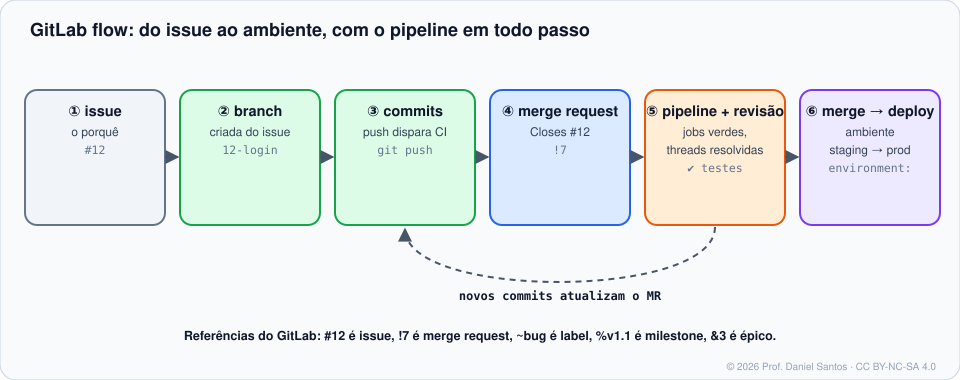

# Módulo 04 · Merge requests e code review

> **Você vai sair daqui sabendo:** abrir merge requests revisáveis (inclusive **direto do `git push`**, com *push options*), revisar com comentários, sugestões e threads, entender aprovações no Free e no Premium, escrever **CODEOWNERS com seções** (sintaxe própria do GitLab), templates de MR e escolher entre merge commit, semi-linear e fast-forward.

⏱ 5–6 h · 🧪 [Laboratório](../../laboratorio/) · ✍️ [Exercícios](exercicios/)

---

## 1. Cenário

A Bia terminou o login. No GitLab, ela abre um **merge request** (`!7`): o pipeline roda, o Caio revisa, as threads abertas precisam ser resolvidas, e só então o código entra na `main`. Tudo fica registrado: quem aprovou, que versão foi testada, por que aquela linha mudou.



## 2. Anatomia de um MR

| Aba | O que mostra |
|---|---|
| **Overview** | descrição, atividades, threads, widget de merge (pipeline, aprovações, conflitos) |
| **Commits** | commits da branch de origem |
| **Pipelines** | as execuções do CI para este MR |
| **Changes** | o diff — onde a revisão acontece |

- **Draft:** título começando com `Draft:` (ou `/draft`) — não pode ser mesclado.
- **Branch de origem → branch de destino** (*source → target*).
- Opções úteis: *Delete source branch*, *Squash commits*, *Merge when pipeline succeeds* (auto-merge).

## 3. Três jeitos de abrir um MR

```bash
# 1) pela interface, a partir do link que o próprio git push mostra:
#    remote: To create a merge request for feature/login, visit: https://gitlab.com/.../merge_requests/new?...

# 2) glab
glab mr create --source-branch feature/login --target-branch main \
  --title "feat: login por e-mail" --description "Closes #12" --draft --remove-source-branch --reviewer caio-qa

# 3) push options — o MR nasce junto com o push (exclusivo do GitLab)
git push -u origin feature/login \
  -o merge_request.create -o merge_request.target=main \
  -o merge_request.title="feat: login por e-mail" -o merge_request.draft \
  -o merge_request.remove_source_branch -o merge_request.label="frontend"
```

| Push option | Efeito |
|---|---|
| `merge_request.create` | cria o MR para a branch enviada |
| `merge_request.target=BRANCH` | branch de destino |
| `merge_request.title="…"` · `merge_request.description="…"` | título e descrição |
| `merge_request.draft` | rascunho |
| `merge_request.merge_when_pipeline_succeeds` | auto-merge quando o pipeline passar |
| `merge_request.remove_source_branch` | apaga a branch ao mesclar |
| `merge_request.label="x"` · `merge_request.assign="user"` | label · responsável |
| `ci.skip` | não roda pipeline neste push |
| `ci.variable="NOME=valor"` | variável para o pipeline deste push |

> 🧠 *Push options* são um recurso do **Git** (`git push -o`): o cliente envia textos que o servidor interpreta como quiser. O GitLab usa para MRs e CI; um servidor qualquer pode ignorar — ou recusar, se não anunciar suporte. O exercício 03 monta um “servidor” local que registra o que recebeu.

## 4. Revisando

- **Comentário de linha** em *Changes*; vários comentários viram uma **revisão** (*Start a review → Submit review*), enviada de uma vez.
- **Threads** precisam ser **resolvidas**; com a configuração *All threads must be resolved* (Módulo 02), MR com thread aberta não mescla.
- **Sugestões**, aplicadas com um clique (e em lote):

````markdown
```suggestion:-0+0
if (!email.includes("@")) return erro("e-mail inválido");
```
````

- **Aprovar:** no **Free**, aprovar é opcional (sinal social). No **Premium**, *approval rules* exigem N aprovações, por grupo de pessoas, e podem exigir os **code owners**.

> 🧠 Revise o código, não a pessoa: pergunte em vez de afirmar, marque detalhes como `nit:`, e elogie o que está bom.

## 5. CODEOWNERS: a versão do GitLab

O arquivo fica em `CODEOWNERS` na raiz, em `docs/` ou em `.gitlab/`. A sintaxe tem **seções**:

```gitignore
# Sem seção: a ÚLTIMA regra que casar vence (como no GitHub)
*                 @aluno

[Frontend] @bia-dev          # dono padrão da seção: vale para as linhas abaixo sem dono
*.js
*.css

[Documentação]
/docs/            @escola-dev/docs

^[Opcional]                  # ^ = seção opcional: pede revisão, mas não exige
*.md              @caio-qa

[Infra][2]                   # [2] = exige 2 aprovações desta seção (Premium)
/.gitlab-ci.yml   @aluno @bia-dev
```

- **Dentro de cada seção**, vale a última regra que casar; **entre seções**, todas se somam — um arquivo pode precisar de donos de várias seções.
- A exigência de aprovação dos donos é recurso **Premium** (marcada na branch protegida, Módulo 06). No Free, o arquivo ainda mostra os donos na interface.

## 6. Templates de MR

Arquivos em `.gitlab/merge_request_templates/`; `Default.md` é aplicado sozinho. Quick actions funcionam:

```markdown
## O que muda
## Por quê
Closes #
## Como testar
- [ ] Testes passando

/assign me
/label ~"status::revisão"
```

## 7. Métodos de merge

| Método (`merge_method`) | Resultado | Exige |
|---|---|---|
| **Merge commit** (`merge`) | commit de merge sempre | nada |
| **Merge commit with semi-linear history** (`rebase_merge`) | commit de merge, mas só se a branch estiver em cima da `main` | rebase quando a `main` andar |
| **Fast-forward merge** (`ff`) | sem commit de merge; histórico linear | rebase quando a `main` andar |

Combine com **squash** (`squash_option`). O botão **Rebase** do MR faz o rebase no servidor.

## 8. MRs pelo terminal

```bash
glab mr list --reviewer=@me                  # o que esperam de você
glab mr view 7 --comments
glab mr diff 7
glab mr checkout 7                           # baixa a branch do MR
glab mr note 7 -m "Testei, ok. /approve"
glab mr approve 7
glab mr update 7 --ready                     # tira do Draft
glab mr merge 7 --squash --remove-source-branch --auto-merge
glab mr rebase 7
```

## 9. Armadilhas comuns

- **`Closes #12` no título** do MR — vai na descrição.
- **CODEOWNERS no lugar errado**: só raiz, `docs/` ou `.gitlab/`. Em `.github/` o GitLab não lê.
- **Seção sem dono e regra sem dono**: a regra fica órfã (nenhum revisor).
- **Push options com servidor que não suporta**: `the receiving end does not support push options`.
- **Fast-forward sem rebase**: o botão Merge some; clique em *Rebase* primeiro.

## 📚 Fontes oficiais

- Merge requests: <https://docs.gitlab.com/user/project/merge_requests/>
- Criar MR (inclui push options): <https://docs.gitlab.com/user/project/merge_requests/creating_merge_requests/>
- Push options: <https://docs.gitlab.com/topics/git/commit/#push-options>
- Revisar e comentar: <https://docs.gitlab.com/user/project/merge_requests/reviews/>
- Sugestões: <https://docs.gitlab.com/user/project/merge_requests/reviews/suggestions/>
- Aprovações: <https://docs.gitlab.com/user/project/merge_requests/approvals/>
- Code owners (sintaxe e seções): <https://docs.gitlab.com/user/project/codeowners/reference/>
- Métodos de merge: <https://docs.gitlab.com/user/project/merge_requests/methods/>
- `glab mr`: <https://docs.gitlab.com/cli/mr/>

---

<sub>© 2026 Prof. Daniel Santos · Curso de GitLab · conteúdo sob CC BY-NC-SA 4.0 · <a href="../../NOTICE.md">aviso de direitos</a></sub>
