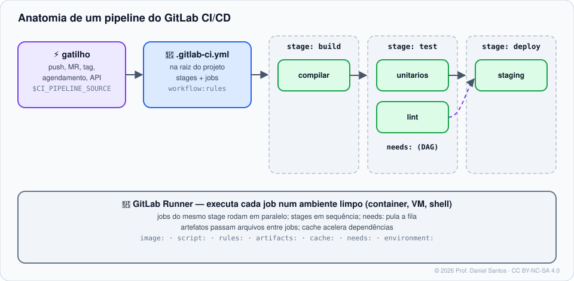

# Módulo 07 · GitLab CI/CD: fundamentos

> **Você vai sair daqui sabendo:** escrever um `.gitlab-ci.yml` do zero — stages, jobs, `image`, `script`, `rules`, `needs`, artefatos —, entender os **tipos de pipeline** (branch, merge request, tag, agendado, manual) e evitar pipelines duplicados com `workflow:rules`, usar as **variáveis predefinidas** (`CI_*`), passar dados entre jobs com **dotenv**, organizar o log em **seções**, e validar tudo antes do push com o *CI Lint*, o schema oficial e o `gitlab-ci-local`.

⏱ 5–6 h · 🧪 [Laboratório](../../laboratorio/) · ✍️ [Exercícios](exercicios/)

---

## 1. Cenário

No GitLab, CI/CD não é um produto à parte: basta um arquivo `.gitlab-ci.yml` na raiz e um **runner** disponível (no GitLab.com já existem runners compartilhados). A cada push, o GitLab cria um **pipeline**; cada **job** roda num ambiente limpo; o resultado aparece no commit, no MR e no board.



## 2. O primeiro pipeline, linha a linha

```yaml
stages: [build, test]          # ordem dos estágios (padrão: .pre, build, test, deploy, .post)

default:
  image: alpine:3.22           # imagem Docker de TODOS os jobs (fixe a versão!)
  interruptible: true          # pipeline novo na mesma branch cancela este
  timeout: 10m

compilar:                      # nome do job (livre)
  stage: build
  script:
    - ./build.sh
  artifacts:
    paths: [dist/]             # arquivos que seguem para os próximos jobs e ficam para download
    expire_in: 1 week

testes:
  stage: test
  needs: [compilar]            # começa assim que "compilar" termina (DAG), com os artefatos dele
  script:
    - ./testes.sh
```

| Palavra-chave | O que faz |
|---|---|
| `script` · `before_script` · `after_script` | comandos (shell da imagem) |
| `image` · `services` | imagem do job · containers auxiliares (ex.: `postgres:17`) |
| `stage` · `needs` | estágio · dependências diretas (pula a ordem dos estágios) |
| `rules` | **quando** o job entra no pipeline (substitui `only/except`, que são legados) |
| `when` | `on_success` (padrão) · `manual` · `always` · `on_failure` · `delayed` · `never` |
| `allow_failure` | falhar não derruba o pipeline |
| `artifacts` · `cache` | entregar arquivos · acelerar dependências (Módulo 08) |
| `variables` | variáveis do pipeline ou do job |
| `tags` | escolher o runner (Módulo 08) |
| `environment` | implantação rastreada (Módulo 08) |

## 3. Tipos de pipeline e `rules`

O GitLab diz de onde veio o pipeline em `$CI_PIPELINE_SOURCE`:

| Valor | Quando |
|---|---|
| `push` | push numa branch ou tag |
| `merge_request_event` | **pipeline de merge request** (roda “no MR”, com variáveis `CI_MERGE_REQUEST_*`) |
| `schedule` | agendamento (*Build → Pipeline schedules*) |
| `web` | botão *Run pipeline* |
| `api` · `trigger` · `pipeline` · `parent_pipeline` | API, token de gatilho, multi-projeto, pipeline filho |

```yaml
testes:
  rules:
    - if: $CI_PIPELINE_SOURCE == "merge_request_event"
    - if: $CI_COMMIT_BRANCH == $CI_DEFAULT_BRANCH
    - changes: [src/**/*]              # só se arquivos de src/ mudaram
```

### O problema dos pipelines duplicados

Com uma branch que tem MR aberto, um push pode gerar **dois** pipelines: o de branch e o de MR. A receita oficial é `workflow:rules` — regras que decidem se o **pipeline inteiro** existe:

```yaml
workflow:
  rules:
    - if: $CI_PIPELINE_SOURCE == "merge_request_event"     # MR: sim
    - if: $CI_COMMIT_BRANCH && $CI_OPEN_MERGE_REQUESTS     # branch COM MR aberto: não (o MR já roda)
      when: never
    - if: $CI_COMMIT_BRANCH                                # branch sem MR: sim
    - if: $CI_COMMIT_TAG                                   # tags: sim
```

## 4. Variáveis predefinidas que você vai usar

| Variável | Exemplo |
|---|---|
| `CI_COMMIT_BRANCH` · `CI_COMMIT_TAG` · `CI_COMMIT_SHORT_SHA` | `main` · `v1.2.0` · `a1b2c3d4` |
| `CI_DEFAULT_BRANCH` | `main` |
| `CI_PIPELINE_SOURCE` · `CI_PIPELINE_ID` · `CI_JOB_ID` | `push` · `9001` · `55120` |
| `CI_PROJECT_PATH` · `CI_PROJECT_ID` · `CI_PROJECT_DIR` | `escola-dev/loja` · `777` · `/builds/escola-dev/loja` |
| `CI_MERGE_REQUEST_IID` · `CI_MERGE_REQUEST_TITLE` | `7` · `feat: login` (só em pipelines de MR) |
| `CI_API_V4_URL` · `CI_JOB_TOKEN` · `CI_REGISTRY_IMAGE` | API, token do job, registry do projeto |

Variáveis **suas** vêm de *Settings → CI/CD → Variables* (podem ser **protected**, **masked** e **hidden** — Módulo 10) ou do YAML (`variables:`). As do YAML com `description` e `value` aparecem **pré-preenchidas** no formulário *Run pipeline*.

> ⚠️ **Variável é texto para o shell.** O GitLab entrega `CI_MERGE_REQUEST_TITLE` como variável de ambiente — seguro se usado **entre aspas** (`"$CI_MERGE_REQUEST_TITLE"`); perigoso com `eval`, `sh -c "…$VAR…"` ou sem aspas. O Módulo 10 mostra o ataque.

## 5. Passando dados entre jobs: dotenv

```yaml
versao:
  stage: build
  script:
    - echo "VERSAO=$(cat VERSION)" > build.env
  artifacts:
    reports:
      dotenv: build.env          # vira variável de ambiente nos jobs seguintes

publicar:
  stage: deploy
  needs: [versao]
  script:
    - echo "Publicando $VERSAO"
```

## 6. Log organizado: seções recolhíveis

```bash
echo -e "\e[0Ksection_start:$(date +%s):instalar[collapsed=true]\r\e[0KInstalando dependências"
npm ci
echo -e "\e[0Ksection_end:$(date +%s):instalar\r\e[0K"
```

## 7. Validando antes do push

| Ferramenta | O que faz |
|---|---|
| **Pipeline editor** (*Build → Pipeline editor*) | edição com validação e visualização do grafo |
| **CI Lint** / `glab ci lint` | valida no servidor, inclusive `include:` |
| **Schema oficial** + `check-jsonschema --builtin-schema vendor.gitlab-ci .gitlab-ci.yml` | valida offline (é o que o corretor do curso usa) |
| **`gitlab-ci-local`** | **executa** os jobs na sua máquina, em Docker (veja o [laboratório](../../laboratorio/)) |

## 8. Pelo terminal

```bash
glab ci lint                         # valida o .gitlab-ci.yml da pasta
glab ci status                       # pipeline da branch atual
glab ci view                         # interface no terminal: jobs, logs, retry
glab ci run -b main --variables "DIAS:3"   # novo pipeline (como o botão Run pipeline)
glab ci trace testes                 # log de um job ao vivo
glab ci retry 55120                  # roda de novo um job
glab ci list                         # pipelines recentes
glab schedule list                   # agendamentos
```

## 9. Custos

No GitLab.com Free, **400 minutos/mês** nos runners da GitLab, contados por namespace de topo. Runners **seus** não consomem minutos. Projetos públicos também consomem cota (exceto contribuições a projetos open source qualificados).

## 10. Armadilhas comuns

- **`image: node:latest`** — o pipeline muda sozinho quando a imagem muda. Fixe a versão (e, para segurança máxima, o digest).
- **Pipelines duplicados** em MR — use `workflow:rules`.
- **`rules` e `only/except` no mesmo job** — não pode; migre para `rules`.
- **Job sem `stage`** vai para `test`; stage não listado em `stages` dá erro.
- **`artifacts` sem `expire_in`** — ocupam armazenamento (padrão do GitLab.com: 30 dias).
- **`: ` dentro de `script` sem aspas** (`- echo Total: 3`) quebra o YAML — use aspas ou `- |`.

## 📚 Fontes oficiais

- Início rápido do CI/CD: <https://docs.gitlab.com/ci/quick_start/>
- Referência do `.gitlab-ci.yml`: <https://docs.gitlab.com/ci/yaml/>
- `rules`: <https://docs.gitlab.com/ci/jobs/job_rules/>
- Tipos de pipeline e `workflow:rules`: <https://docs.gitlab.com/ci/yaml/workflow/>
- Pipelines de merge request: <https://docs.gitlab.com/ci/pipelines/merge_request_pipelines/>
- Variáveis predefinidas: <https://docs.gitlab.com/ci/variables/predefined_variables/>
- Passar variáveis entre jobs (dotenv): <https://docs.gitlab.com/ci/variables/job_scripts/#pass-an-environment-variable-to-another-job>
- Seções recolhíveis no log: <https://docs.gitlab.com/ci/jobs/job_logs/#custom-collapsible-sections>
- Validar (CI Lint): <https://docs.gitlab.com/ci/yaml/lint/>
- Minutos de computação: <https://docs.gitlab.com/ci/pipelines/compute_minutes/>
- `glab ci`: <https://docs.gitlab.com/cli/ci/> · gitlab-ci-local: <https://github.com/firecow/gitlab-ci-local>

---

<sub>© 2026 Prof. Daniel Santos · Curso de GitLab · conteúdo sob CC BY-NC-SA 4.0 · <a href="../../NOTICE.md">aviso de direitos</a></sub>
