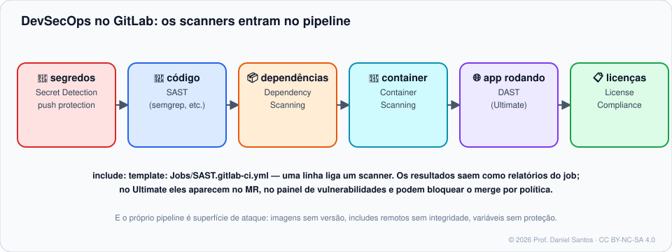

# Módulo 10 · DevSecOps: segurança dentro do pipeline

> **Você vai sair daqui sabendo:** ligar os **scanners** do GitLab (SAST, segredos, dependências, contêiner, IaC), entender **o que cada plano entrega**, **ler e barrar** um relatório de segurança no pipeline, reagir a um **segredo vazado**, endurecer **variáveis, token do job e runners**, e conhecer as **políticas de segurança** que obrigam todos os projetos a seguir as mesmas regras.

⏱ 4–5 h · 🧪 [Laboratório](../../laboratorio/) · ✍️ [Exercícios](exercicios/)



---

## 1. Cenário

Uma auditoria encontrou: uma chave da nuvem num commit de 2024, uma biblioteca com CVE crítica em produção, variáveis com senha visíveis no log, e um projeto que lê artefatos de **qualquer** outro da instância com o token do job. Nenhuma ferramenta nova é necessária: o GitLab já traz tudo isso — é questão de **ligar e configurar**.

## 2. “Shift left”: onde cada verificação acontece

| Momento | Ferramenta | Pega o quê |
|---|---|---|
| Ao digitar um comentário/issue | *Client-side secret detection* | token colado por engano |
| No `git push` | **Secret push protection** | segredo antes de entrar no repositório |
| No pipeline do MR | SAST, segredos, dependências, contêiner, IaC | código, libs, imagem e infraestrutura vulneráveis |
| No ambiente de teste | DAST, API fuzzing | falhas só visíveis com o app rodando |
| Depois | Vulnerability report, políticas | o acompanhamento e o “não pode” |

## 3. Ligando os scanners

```yaml
stages: [build, test]          # os templates usam o estágio test

include:
  - template: Jobs/SAST.gitlab-ci.yml                  # Semgrep e analisadores por linguagem
  - template: Jobs/Secret-Detection.gitlab-ci.yml      # segredos no código
  - template: Jobs/Dependency-Scanning.v2.gitlab-ci.yml  # dependências via SBOM (CycloneDX)
  - template: Jobs/Container-Scanning.gitlab-ci.yml    # a imagem que você construiu
  - template: Jobs/SAST-IaC.gitlab-ci.yml              # Terraform, Kubernetes, Dockerfile…

secret_detection:
  variables:
    SECRET_DETECTION_HISTORIC_SCAN: "true"             # 1ª vez: varre o histórico inteiro
```

- O **Dependency Scanning por SBOM** ficou GA no **GitLab 19.0**; o analisador antigo (Gemnasium) foi depreciado. Use o template **`.v2`**.
- Cada job gera um relatório JSON (`gl-sast-report.json`, `gl-secret-detection-report.json`…) como artefato — que você pode ler com `jq` (exercício 02).
- Também existem como **componentes** no CI/CD Catalog (Módulo 08), com `inputs` em vez de variáveis.

## 4. O que cada plano entrega

| Recurso | Free | Premium | Ultimate |
|---|:-:|:-:|:-:|
| SAST, detecção de segredos no pipeline, container scanning (job + relatório JSON) | ✅ | ✅ | ✅ |
| Aviso de segredo ao escrever issue/comentário | ✅ | ✅ | ✅ |
| Resultados no widget do MR, aba Security, **Vulnerability report** | | | ✅ |
| **Secret push protection** (bloqueia o push) | | | ✅ |
| Dependency scanning, DAST, API fuzzing | | | ✅ |
| **Políticas de segurança** (execução de scans, aprovação de MR, execução de pipeline) | | | ✅ |

> 💡 No Free você não tem o painel, mas tem o **dado**: o relatório JSON. Um job que lê o relatório e falha com `Critical`/`High` dá o “portão de segurança” sem pagar nada — é o exercício 02.

## 5. Segredo vazou. E agora?

1. **Revogue primeiro** — o histórico do Git é público para quem clonou; apagar o commit **não** desvaloriza o segredo. Tokens do GitLab revogam em *User settings → Access tokens* (ou a API `POST /personal_access_tokens/self/rotate`).
2. Gere um novo e guarde em **variável de CI/CD mascarada e protegida** (ou num cofre: HashiCorp Vault, nuvem via OIDC — Módulo 08).
3. Só então limpe o histórico (`git filter-repo`) e peça a todos que reclonem.
4. Em projetos **públicos** no GitLab.com, tokens `glpat-` vazados são **revogados automaticamente**.

## 6. Endurecendo o CI/CD

| Item | Faça |
|---|---|
| **Variáveis** | *Masked* (some do log), *Protected* (só em branch/tag protegida), *Hidden* (nem a interface mostra depois de salvar), escopo de **ambiente** |
| **Token do job** (`CI_JOB_TOKEN`) | *Settings → CI/CD → Job token permissions*: **allowlist** de quem pode usar o token **contra** este projeto |
| **Runners** | Runners **protegidos** para deploy; nada de `shell` compartilhado; `docker.sock` nunca em projeto público |
| **Includes e imagens** | Versões fixas (`ref:` / `@1.2.0` / digest) — Módulo 08 |
| **Forks** | Pipelines de MR vindos de fork rodam no **fork**, sem as suas variáveis; rodar no projeto pai exige um Developer+ clicar *Run pipeline* conscientemente |
| **Compliance** | *Merge request approval policies* exigem aprovação do time de segurança se surgir vulnerabilidade nova |

## 7. Políticas de segurança (Ultimate)

Ficam num **projeto de políticas** ligado ao grupo, e valem para todos os projetos abaixo:

```yaml
# .gitlab/security-policies/policy.yml  (no projeto de políticas)
scan_execution_policy:
  - name: Scans obrigatórios
    enabled: true
    rules:
      - type: pipeline
        branches: ["*"]
    actions:
      - scan: secret_detection
      - scan: sast
```

Ninguém “esquece” de incluir o template: a política injeta os jobs.

## 8. Cadeia de suprimentos

- **SBOM**: o dependency scanning gera CycloneDX (`gl-sbom-*.cdx.json`) — o inventário do que vai para produção.
- **Assinatura sem chave** com Sigstore/cosign usando `id_tokens` (`aud: sigstore`).
- **Proveniência SLSA** de artefatos: variável `RUNNER_GENERATE_ARTIFACTS_METADATA: "true"`.

## 9. Armadilhas comuns

- **Template sem o estágio `test`**: o pipeline falha com “chosen stage does not exist”.
- **Apagar o commit e não revogar**: o segredo continua válido em todos os clones e caches.
- **Variável “Masked” com valor curto ou com caracteres não suportados**: o GitLab recusa — e alguém desiste e salva sem máscara.
- **`allow_failure: true` em todo scan**: o relatório existe, mas ninguém olha.

## 📚 Fontes oficiais

- Application security (visão geral): <https://docs.gitlab.com/user/application_security/>
- SAST: <https://docs.gitlab.com/user/application_security/sast/>
- Detecção de segredos (pipeline, push protection, cliente): <https://docs.gitlab.com/user/application_security/secret_detection/>
- Dependency scanning por SBOM: <https://docs.gitlab.com/user/application_security/dependency_scanning/dependency_scanning_sbom/>
- Container scanning: <https://docs.gitlab.com/user/application_security/container_scanning/>
- Políticas de segurança: <https://docs.gitlab.com/user/application_security/policies/>
- Variáveis de CI/CD (masked, protected, hidden): <https://docs.gitlab.com/ci/variables/>
- Token do job e allowlist: <https://docs.gitlab.com/ci/jobs/ci_job_token/>
- API de escopo do token do job: <https://docs.gitlab.com/api/project_job_token_scopes/>
- Pipelines de MR vindos de forks: <https://docs.gitlab.com/ci/pipelines/merge_request_pipelines/#run-pipelines-in-the-parent-project>

---

<sub>© 2026 Prof. Daniel Santos · Curso de GitLab · conteúdo sob CC BY-NC-SA 4.0 · <a href="../../NOTICE.md">aviso de direitos</a></sub>
