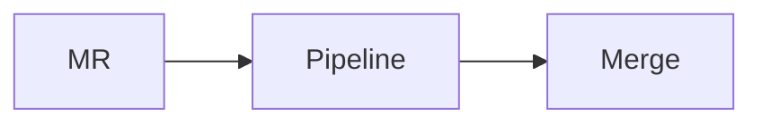

# ✍️ GLFM, quick actions, atalhos e URLs

## Referências automáticas (GitLab Flavored Markdown)

| Escreva | Vira link para |
|---|---|
| `#12` · `grupo/projeto#12` | issue |
| `!7` · `grupo/projeto!7` | merge request |
| `%"v1.1"` | milestone |
| `~bug` · `~"precisa triagem"` · `~prioridade::alta` | label (com escopo, `::`) |
| `@bia-dev` · `@escola-dev/backend` | pessoa · grupo (notifica!) |
| `a1b2c3d` · `v1.0.0...v1.1.0` | commit · comparação |
| `&5` · `*iteration:12` | épico · iteração (Premium+) |

## Markdown que só o GitLab tem

````markdown
[[_TOC_]]                                  ← sumário automático

- [ ] tarefa aberta
- [x] tarefa feita



$`E = mc^2`$                               ← matemática em linha

<details><summary>Log completo</summary>
…texto longo…
</details>

{+ adicionado +} · {- removido -}           ← diff em linha
````

## Quick actions (em issues, MRs e comentários)

| Ação | Onde | Efeito |
|---|---|---|
| `/assign @bia-dev` · `/assign me` · `/unassign` | issue, MR | responsáveis |
| `/label ~bug ~"precisa triagem"` · `/unlabel ~bug` · `/relabel ~x` | issue, MR | labels |
| `/milestone %"v1.1"` · `/due 2026-12-01` | issue, MR | milestone, prazo |
| `/estimate 2h` · `/spend 30m` | issue, MR | controle de tempo |
| `/close` · `/reopen` · `/title Novo título` | issue, MR | estado, título |
| `/confidential` | issue | só membros veem |
| `/duplicate #10` · `/relate #11` · `/move grupo/outro` | issue | organização |
| `/assign_reviewer @caio-qa` | MR | pede revisão |
| `/draft` · `/ready` | MR | rascunho ⇄ pronto |
| `/approve` · `/unapprove` · `/merge` | MR | aprovar, mesclar (respeita as regras) |
| `/rebase` · `/target_branch main` | MR | manutenção da branch |
| `/todo` · `/done` · `/award :+1:` | issue, MR | pessoal |
| `/copy_metadata #12` | issue, MR | copia labels e milestone |

Várias por comentário, uma por linha. Em templates (`.gitlab/issue_templates/*.md`), elas rodam quando o issue é criado.

## Atalhos de teclado

| Tecla | Faz |
|---|---|
| `?` | mostra **todos** os atalhos |
| `/` ou `s` | busca |
| `t` | localizar arquivo no projeto |
| `.` | abre o **Web IDE** no arquivo/MR atual |
| `y` | troca a URL do arquivo por um **permalink** (fixo no commit) |
| `Ctrl/Cmd + Enter` | envia o comentário |
| `r` | responde citando o texto selecionado |

## Truques de URL

| URL | Faz |
|---|---|
| `…/-/blob/main/app.py#L10-20` | destaca as linhas 10 a 20 |
| `…/-/compare/v1.0.0...v1.1.0` | diferença entre duas refs |
| `…/-/merge_requests/7.diff` · `.patch` | o MR como diff/patch puro |
| `…/-/issues/new?issuable_template=Bug&issue[title]=Erro` | issue pré-preenchido |
| `…/-/merge_requests/new?merge_request[source_branch]=feature/x` | MR já com a branch |
| `…/-/releases/permalink/latest` | sempre a última release |
| `…/-/pipelines/new?ref=main&var[AMBIENTE]=homologacao` | formulário de pipeline pré-preenchido |
| `https://gitlab.com/-/graphql-explorer` | explorador da API GraphQL |

<sub>© 2026 Prof. Daniel Santos · Curso de GitLab · CC BY-NC-SA 4.0 · Fontes: [GLFM](https://docs.gitlab.com/user/markdown/) · [quick actions](https://docs.gitlab.com/user/project/quick_actions/) · [atalhos](https://docs.gitlab.com/user/shortcuts/)</sub>
